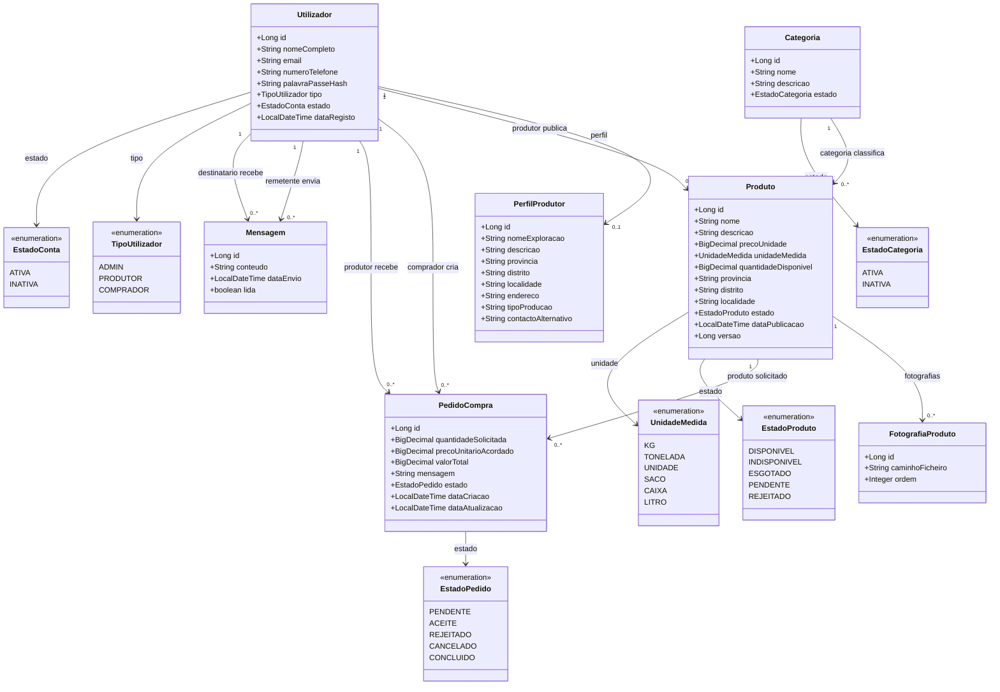

# Diagramas do AgroMarket

Esta página usa blocos Mermaid, que o GitHub renderiza diretamente como diagramas. Os arquivos PlantUML continuam disponíveis como fontes editáveis:

- [Diagrama de classes PlantUML](diagrama-classes.puml)
- [Diagrama de casos de uso PlantUML](diagrama-casos-de-uso.puml)

## Diagrama de classes

## Diagrama de casos de uso

```mermaid
flowchart LR
    Visitante([Visitante])
    Comprador([Comprador])
    Produtor([Produtor])
    Admin([Administrador])

    subgraph Sistema["Sistema AgroMarket"]
        UC_Categorias((Consultar categorias))
        UC_Pesquisar((Pesquisar produtos))
        UC_Detalhes((Consultar produto e fotografias públicas))
        UC_Registar((Registar conta))
        UC_Login((Iniciar sessão))

        UC_Conta((Gerir dados pessoais))
        UC_Senha((Alterar palavra-passe))
        UC_Desativar((Desativar própria conta))
        UC_MensagemEnviar((Enviar mensagens))
        UC_Conversas((Consultar conversas))
        UC_Lida((Marcar mensagem como lida))

        UC_DashComprador((Consultar dashboard de comprador))
        UC_CriarPedido((Criar pedido de compra))
        UC_Acompanhar((Consultar pedidos próprios))
        UC_Cancelar((Cancelar pedido pendente))

        UC_DashProdutor((Consultar dashboard de produtor))
        UC_PerfilProdutor((Gerir perfil de produtor))
        UC_Produtos((Gerir produtos e fotografias próprias))
        UC_Recebidos((Consultar pedidos recebidos))
        UC_AceitarRejeitar((Aceitar ou rejeitar pedido))
        UC_Concluir((Concluir pedido aceite))

        UC_DashAdmin((Consultar dashboard administrativo))
        UC_CategoriasAdmin((Gerir categorias))
        UC_Moderar((Aprovar ou rejeitar produtos))
        UC_Utilizadores((Ativar ou desativar contas))
        UC_PedidosAdmin((Consultar pedidos da plataforma))
    end

    Visitante --> UC_Categorias
    Visitante --> UC_Pesquisar
    Visitante --> UC_Detalhes
    Visitante --> UC_Registar
    Visitante --> UC_Login

    Comprador --> UC_Conta
    Comprador --> UC_Senha
    Comprador --> UC_Desativar
    Comprador --> UC_MensagemEnviar
    Comprador --> UC_Conversas
    Comprador --> UC_Lida
    Comprador --> UC_DashComprador
    Comprador --> UC_CriarPedido
    Comprador --> UC_Acompanhar
    Comprador --> UC_Cancelar

    Produtor --> UC_Conta
    Produtor --> UC_Senha
    Produtor --> UC_Desativar
    Produtor --> UC_MensagemEnviar
    Produtor --> UC_Conversas
    Produtor --> UC_Lida
    Produtor --> UC_DashProdutor
    Produtor --> UC_PerfilProdutor
    Produtor --> UC_Produtos
    Produtor --> UC_Recebidos
    Produtor --> UC_AceitarRejeitar
    Produtor --> UC_Concluir

    Admin --> UC_Conta
    Admin --> UC_Senha
    Admin --> UC_Desativar
    Admin --> UC_MensagemEnviar
    Admin --> UC_Conversas
    Admin --> UC_Lida
    Admin --> UC_DashAdmin
    Admin --> UC_CategoriasAdmin
    Admin --> UC_Moderar
    Admin --> UC_Utilizadores
    Admin --> UC_PedidosAdmin
```

As operações autenticadas exigem um token JWT. As permissões também dependem do papel e da propriedade do recurso; consulte [rotas.md](../rotas.md) para as regras por endpoint.
